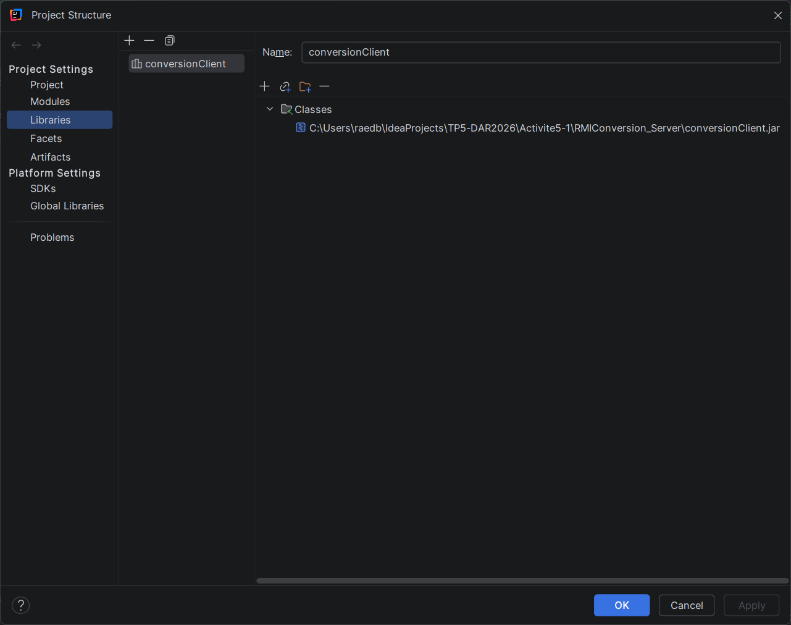
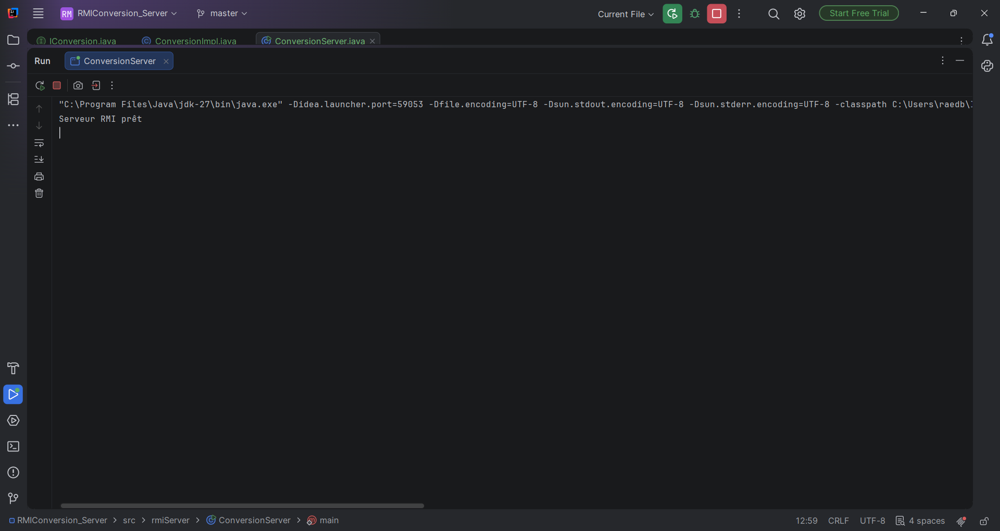
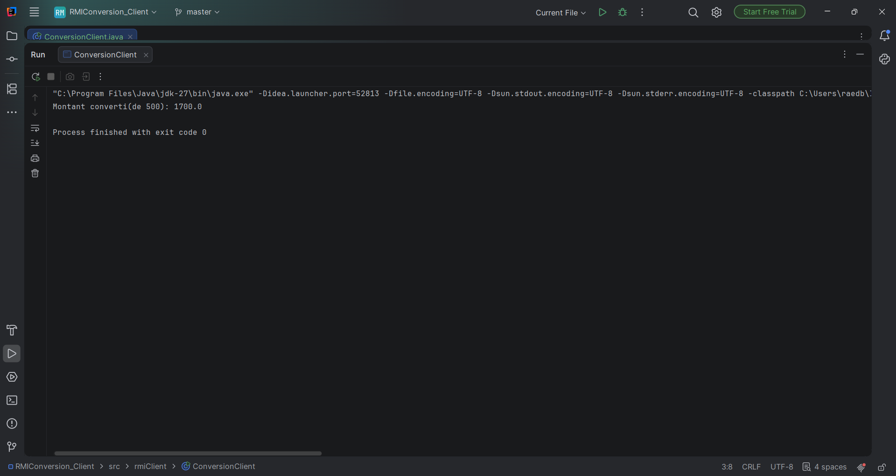

# TP5 - Activité 5-1 : Service de conversion de devise (Java RMI)

## Étape 2 : Développement du serveur

Le projet `RMIConversion_Server` contient l'interface distante `IConversion` (méthode `convertirMontant`), son implémentation `ConversionImpl` et la classe `ConversionServer`, qui active le RMIRegistry, crée l'objet distant et publie sa référence dans l'annuaire.

- L'interface étend `Remote` et ses méthodes déclarent `RemoteException`.
- Le serveur enregistre l'objet distant dans le registre pour que les clients puissent le retrouver.

## Étape 3 : Développement du client

Le fichier `conversionClient.jar` contient uniquement l'interface `IConversion` (sans `ConversionImpl`). Il est ajouté comme bibliothèque au projet `RMIConversion_Client`, dont la classe `ConversionClient` cherche l'objet distant dans le registre et appelle `convertirMontant(500)`.

### Bibliothèque ajoutée au client

- Le client n'a besoin que de l'interface pour compiler et appeler le service.
- Le code de l'implémentation reste côté serveur.

## Étape 4 : Exécution de l'application

Le serveur est lancé en premier, puis le client invoque la méthode distante.

### Exécution

**Serveur**

**Client**

- Le serveur affiche « Serveur RMI prêt » et reste en attente des appels.
- Le client affiche `Montant converti(de 500): 1700.0`, soit un taux de 3,4.
- La conversion est calculée côté serveur : la communication RMI fonctionne correctement.