# TP5 - Activité 5-1 : Service de conversion de devise (Java RMI)

## Étape 2 : Développement du serveur

Le projet `RMIConversion_Server` contient l'interface distante `IConversion` (méthode `convertirMontant`), son implémentation `ConversionImpl` et la classe `ConversionServer`, qui active le RMIRegistry, crée l'objet distant et publie sa référence dans l'annuaire.

- L'interface étend `Remote` et ses méthodes déclarent `RemoteException`.
- Le serveur enregistre l'objet distant dans le registre pour que les clients puissent le retrouver.

## Étape 3 : Développement du client

Le fichier `conversionClient.jar` contient uniquement l'interface `IConversion` (sans `ConversionImpl`). Il est ajouté comme bibliothèque au projet `RMIConversion_Client`, dont la classe `ConversionClient` cherche l'objet distant dans le registre et appelle `convertirMontant(500)`.

### Bibliothèque ajoutée au client

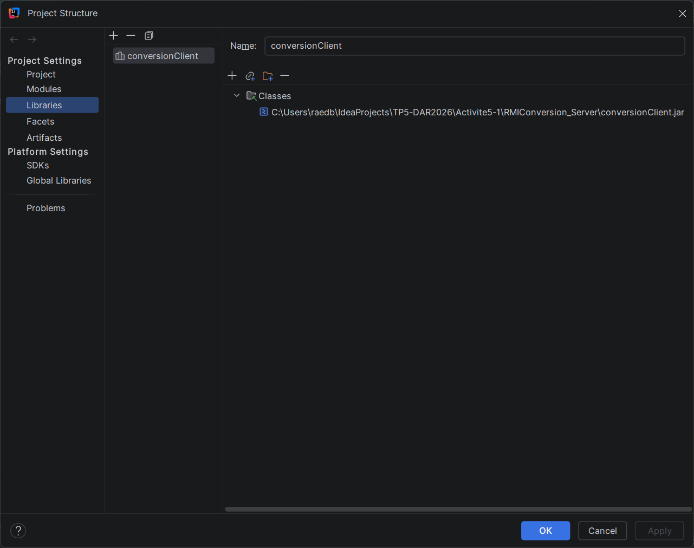

- Le client n'a besoin que de l'interface pour compiler et appeler le service.
- Le code de l'implémentation reste côté serveur.

## Étape 4 : Exécution de l'application

Le serveur est lancé en premier, puis le client invoque la méthode distante.

### Exécution

**Serveur**

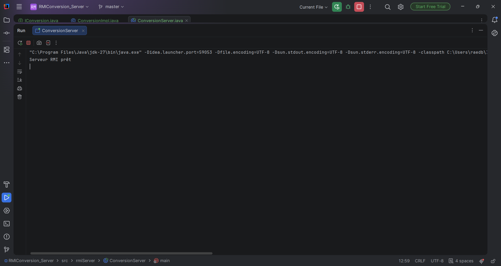

**Client**

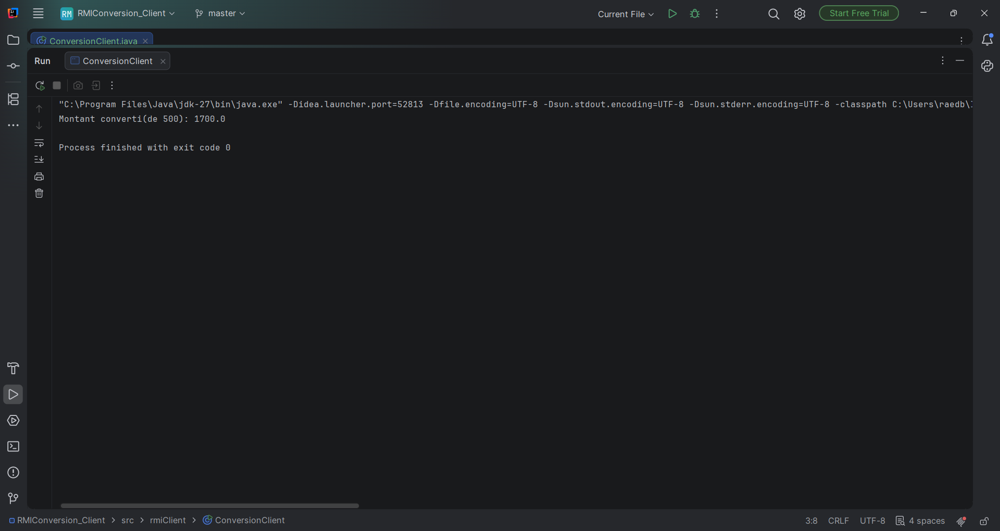

- Le serveur affiche « Serveur RMI prêt » et reste en attente des appels.
- Le client affiche `Montant converti(de 500): 1700.0`, soit un taux de 3,4.
- La conversion est calculée côté serveur : la communication RMI fonctionne correctement.

---

# TP5 - Activité 5-2 : Service de banque avec RMI et JNDI

## Étape 2 : Développement du serveur

Le projet `RMIBanque_Server` contient la classe sérialisable `Compte` (package `metier`), l'interface distante `IBanque` et son implémentation `BanqueImpl` (package `rmiService`), ainsi que la classe `BanqueServer` (package `rmiServer`). Les comptes sont stockés dans une `List`.

### Structure du projet

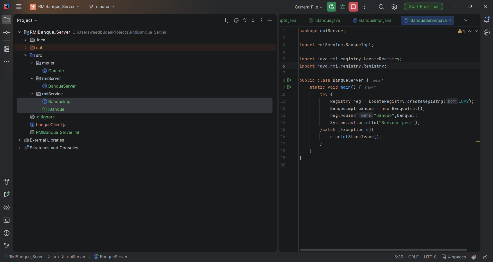

- `IBanque` étend `Remote` et ses méthodes `creerCompte` et `getInfoCompte` déclarent `RemoteException`.
- `Compte` implémente `Serializable` pour pouvoir être transmis du client au serveur.
- `BanqueImpl` refuse la création d'un compte dont le code existe déjà.

## Étape 3 : Développement du client

Le fichier `banqueClient.jar` est généré avec la commande `jar` et ne contient que `Compte` et `IBanque` (sans `BanqueImpl`). Il est ensuite ajouté comme bibliothèque au projet `RMIBanque_Client`.

### Génération du JAR

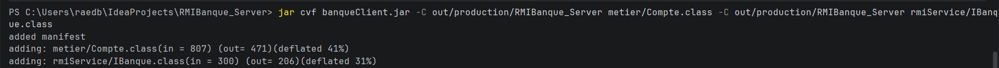

### Bibliothèque ajoutée au client

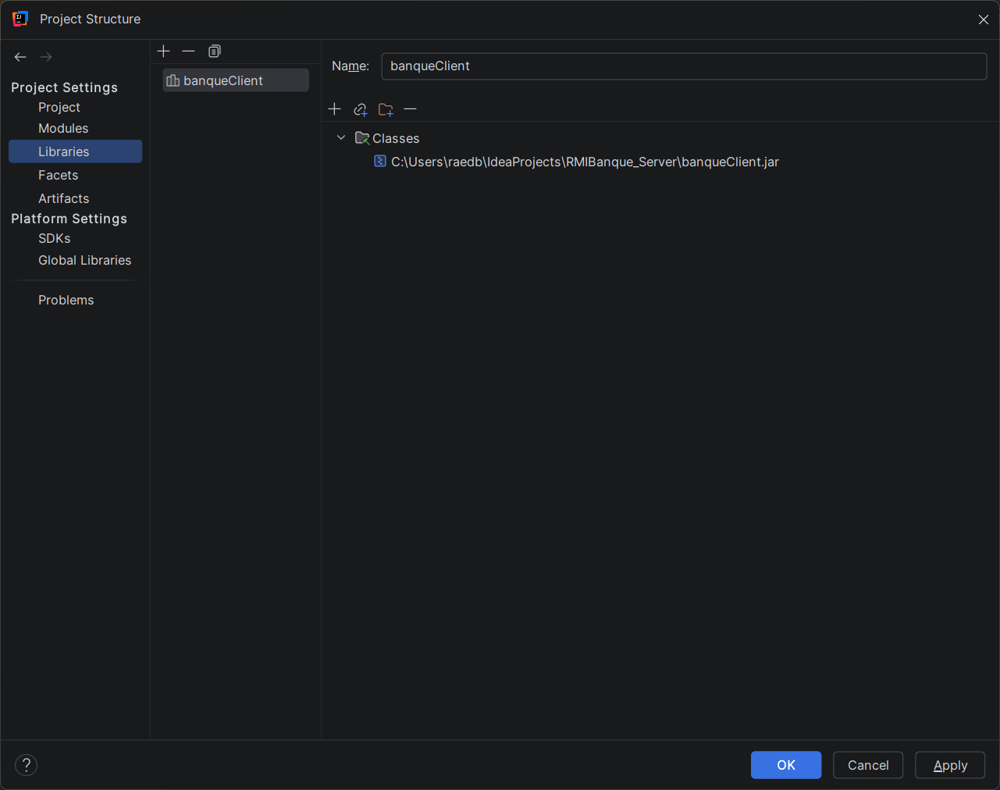

- Le JAR contient uniquement les deux classes dont le client a besoin.
- Le code de l'implémentation reste côté serveur.

## Étape 4 : Exécution de l'application

Le serveur crée le registre RMI sur le port 1099 et y publie l'objet `BanqueImpl` sous le nom `Banque`. Le client récupère le registre, cherche l'objet distant, puis crée le compte 1 avec un solde de 500 et consulte ses informations.

### Code

**Serveur**

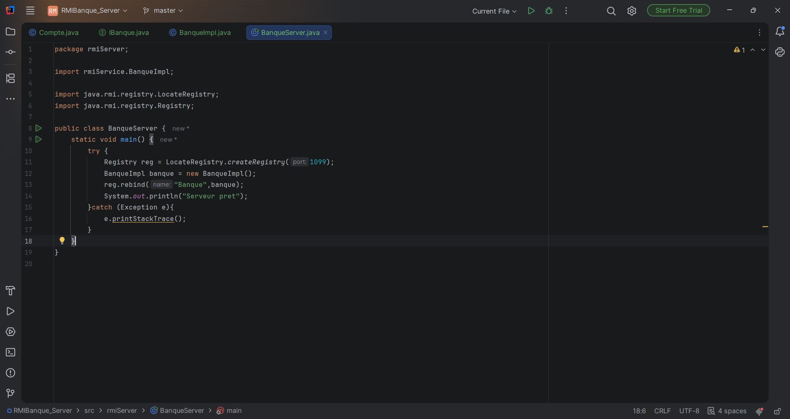

**Client**

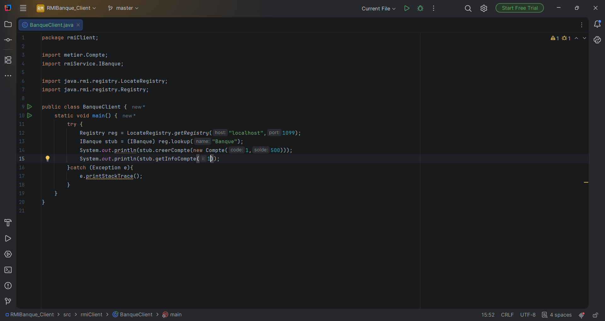

### Exécution

**Serveur**

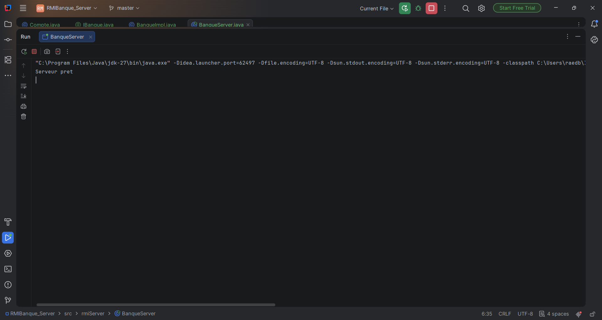

**Client**

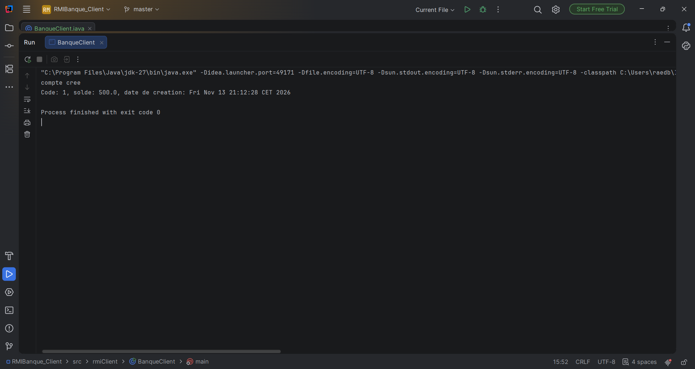

- Le serveur affiche « Serveur pret » et reste en attente des appels.
- Le client affiche « compte cree », puis les informations du compte (code 1, solde 500.0, date de création).
- La création et la consultation sont exécutées côté serveur : la communication RMI fonctionne correctement.

## Étape 5 : Utilisation de JNDI pour l'enregistrement RMI

Le registre RMI n'est plus utilisé directement : le serveur enregistre l'objet distant avec un `InitialContext`, et le client le recherche avec `ctx.lookup("Banque")`. Le fichier `jndi.properties`, placé dans `src` des deux projets, indique la fabrique de contexte RMI et l'adresse du registre.

### Exécution

**Serveur**

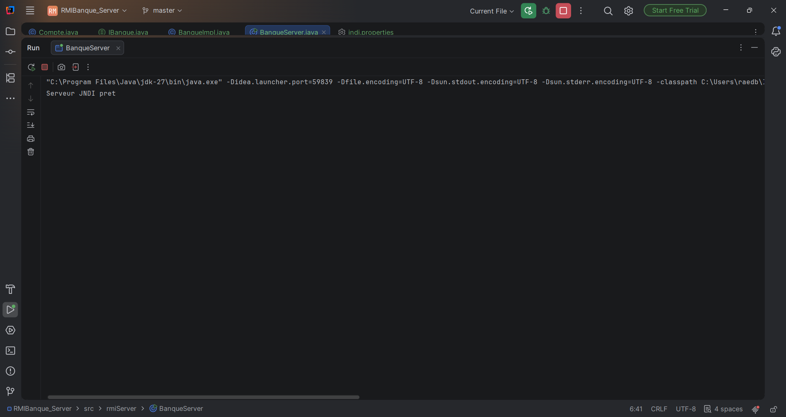

**Client (code et exécution)**

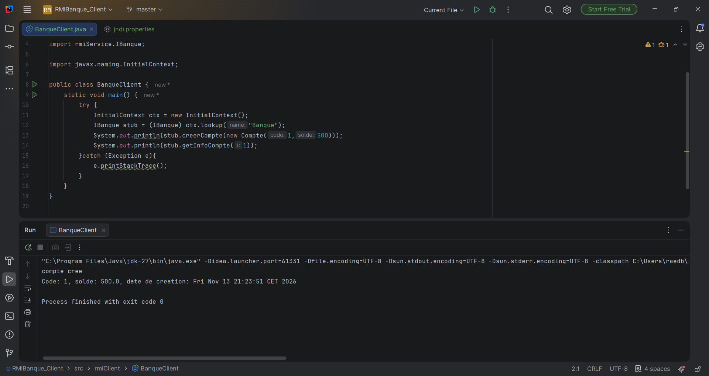

- Le serveur affiche « Serveur JNDI pret » : l'objet est enregistré via JNDI.
- Le client obtient `IBanque` avec `InitialContext.lookup` au lieu du registre RMI, et le résultat est identique à l'étape 4.
- JNDI fournit une API de nommage standard : le fournisseur (ici le registre RMI) se choisit dans `jndi.properties`, sans changer le code.

